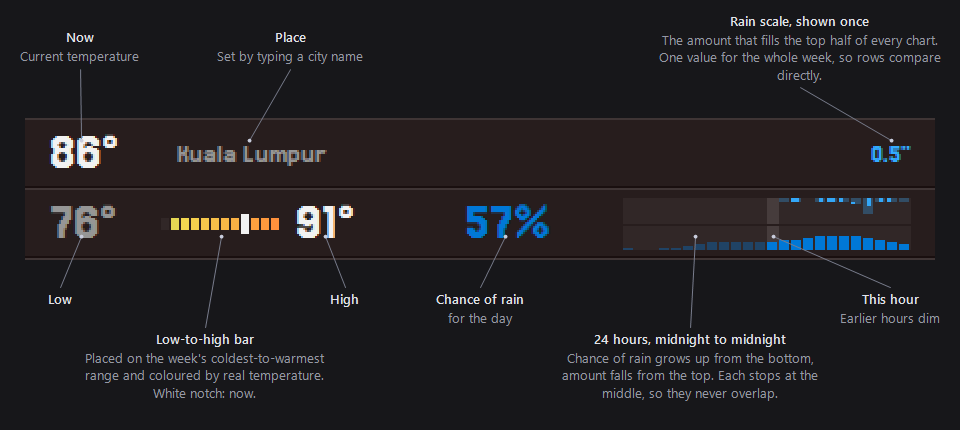
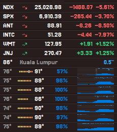
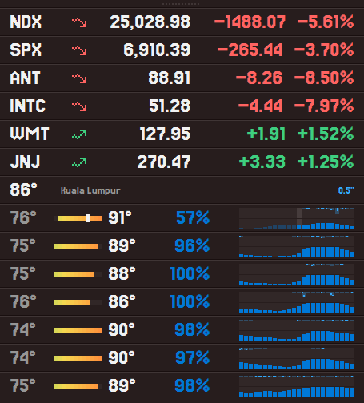
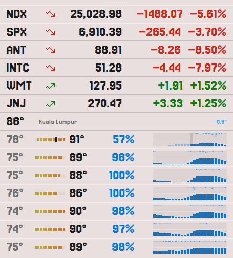

# Pixill

A small retro-pixel desktop widget for Windows: your stocks and a week of
weather in one window that sits on the wallpaper, underneath everything else.


Pixill was written to replace the Windows Widgets board for the two things its
author actually looked at. On the author's machine the Widgets board was
holding about 770 MB of memory. Pixill holds about 50 MB, makes no network
requests while it is covered by another window, and is a single 175 KB exe
that builds with the compiler already inside Windows.

- **Stocks:** name, a zig-zag trend arrow, price, and the day's change in
  points and percent.
- **Weather:** the temperature now, then seven days of low, high, chance of
  rain, and a 24-hour rain chart per day.
- **Quiet:** it refreshes only when it is due *and* you can see it.
- **Yours:** a plain JSON file holds every setting and reloads when you save it.
- **No accounts, no keys, no installer.**

## Reading the weather rows



Each day is one compact row, today first. Days and hours are not labelled:
the first row is today and every chart runs from midnight to midnight, so the
position already tells you.

The chart carries two things at once. **Chance of rain** rises from the bottom
of the row and **how much rain** falls from the top, drawn as falling pixels
that get taller and faster as the amount grows. Each is limited to half the
row, so the two can never cover each other. A full bottom half always means
100%. A full top half means the amount printed once in the header (0.25" by
default, roughly where "heavy rain" begins); if any hour in the week exceeds
that, the scale steps up for the whole week so every row still compares
directly with every other.

## Get it

You need Windows 10 or 11. Pick one from the
[latest release](https://github.com/horusscope/pixill/releases/latest):

| | `Pixill.exe` | `Pixill-1.0.1.msi` |
|---|---|---|
| What it is | The whole program in one file | An installer |
| Where it goes | Wherever you put it | `C:\Program Files\Pixill`, with a Start menu entry |
| Starts with Windows | Only if you tick it in the tray menu | Yes, and you can untick it in the tray menu |
| Settings file | `config.json` beside the exe | `%APPDATA%\Pixill\config.json` |
| Needs admin | No | Yes |
| To remove | Exit from the tray icon and delete the file | Settings, Apps, Pixill, Uninstall |

Run it and the widget appears at the top right of your main display with five
example symbols. Click the weather block and type your city.

Both files are built by GitHub Actions from the tagged commit, never on a
private machine, and each carries a signed build attestation you can check
(needs the [GitHub CLI](https://cli.github.com/)):

```
gh attestation verify Pixill.exe -R horusscope/pixill
```

`SHA256SUMS.txt` in the release does the simpler job of confirming the
download arrived intact. Neither file has a Windows (Authenticode) signature
yet, so SmartScreen may still warn the first time you run one;
[`docs/signing.md`](docs/signing.md) explains what is in place and what is
pending.

Installer switches, for scripted installs:
`msiexec /i Pixill-1.0.1.msi AUTOSTART=0` leaves it out of Windows start-up,
and `LAUNCH=0` stops it starting when the install finishes. Uninstalling
leaves your settings file in place.

### Or build it yourself

Nothing has to be installed for this either.

1. Download or clone this repository.
2. Right-click `build.ps1` and choose **Run with PowerShell** (or run
   `powershell -ExecutionPolicy Bypass -File build.ps1`). It produces
   `bin\Pixill.exe` in a few seconds.
3. Run `bin\Pixill.exe`.

## Using it

| To | Do this |
|---|---|
| Add a symbol | Right-click, **Add symbol…**, type a ticker or a company name |
| Remove a symbol | Right-click its row, **Remove** |
| Reorder symbols | Drag a row up or down |
| Move the window | Drag the dotted strip at the top, or anywhere in the weather block |
| Change the city | Right-click, **Set weather location…** |
| Refresh now, edit settings, exit | Right-click the widget or the tray icon |
| Start with Windows | Tray icon, **Start with Windows** |

The dots in the top strip turn red when a data source cannot be reached.

## Settings

Everything lives in one `config.json`, created on first run: beside the exe,
or in `%APPDATA%\Pixill` when Pixill is installed under Program Files.
**Edit config…** in the right-click menu opens it. Save the file and the
widget reloads.

| Key | Default | Meaning |
|---|---|---|
| `stocks.symbols` | five examples | Yahoo Finance symbols, in display order (`^NDX`, `SPY`, `BTC-USD`, …) |
| `stocks.labels` | none | Optional display names, for example `"^GSPC": "SPX"` |
| `stocks.refreshMs` | `60000` | How often quotes refresh while visible |
| `weather.refreshMs` | `600000` | How often the forecast refreshes while visible |
| `weather.days` | `7` | Rows of forecast, 1 to 16 |
| `weather.amountScale` | `0.25` | Rain amount that fills the top half of a chart row |
| `weather.temperatureUnit`, `weather.precipitationUnit` | `fahrenheit`, `inch` | Or `celsius`, `mm` |
| `weather.animateRain`, `weather.rainFps` | `true`, `10` | The falling-rain animation |
| `stocks.rowVh`, `weather.rowVh` | `2.4` | Row height, in hundredths of the display height (see sizes below) |
| `theme` | `system` | Follow Windows, or force `dark` / `light` |
| `accentTint` | `0.08` | How far the background leans toward your Windows accent colour |
| `pixelFont`, `pixelFontGrid` | Jersey 15, `15` | The font file and its design height; `""` falls back to Segoe UI |
| `opacity` | `0.92` | Window opacity |

## Design decisions

**It does nothing unless you can see it.** A widget on the desktop is covered
most of the day. When a refresh comes due, Pixill first works out how much of
its own rectangle is hidden by the windows above it; if less than 10% shows,
it skips the request and simply checks again a second later, with no network
use. The same check pauses the rain animation, and nothing is fetched while
the session is locked.

**Polling, at the rate you asked for.** Finance sites push prices several
times a second. A glance-able widget does not need that, so Pixill asks once
a minute for quotes and once every ten minutes for weather (the forecast
source itself only changes every fifteen).

**Sizes follow the display, in whole pixels.** Rows are sized in hundredths of
the display height, so the widget takes the same share of a 1080p and a 4K
screen. A pixel font is only sharp at whole multiples of its design size, so
text snaps to the nearest multiple and the arrows, temperature blocks and
raindrops use the same pixel size as the text. That is why the sizes come in
steps rather than a smooth range:

| Half size (`rowVh` 1.25) | Full size (`rowVh` 2.4) |
|---|---|
|  |  |

**The stock rows set the width.** The weather block fits itself to whatever
width the stock rows need; its charts take the space that is left.

**Colour means one thing each.** Green and red are reserved for gain and loss
and never change. The temperature bar runs cold-blue to hot-red by actual
temperature and sits on the week's range, so a warm day is visibly further
right than a cold one. Rain uses the Windows highlight colour.

**It follows the Windows theme where Windows has an opinion.** Windows offers
a dark/light switch and one accent colour. Background, text and dividers
follow the switch, and the background leans 8% toward the accent so it belongs
on your desktop without costing the numbers their contrast. Changes in
Settings apply without a restart.



**No runtime to install.** Pixill is plain C# on Windows Forms, targeting the
.NET Framework that ships inside Windows 10 and 11, with custom drawing and no
packages. The web-based widget hosts it replaces are the reason for the
memory difference above.

## Privacy

Pixill has no account, no telemetry, no update check and no server of its
own. It makes exactly two kinds of request, both needed to show what you
asked it to show, and only while it is visible:

- to **Yahoo Finance**, the symbols in your list (and what you type in the
  symbol search box);
- to **Open-Meteo**, the latitude and longitude of the city you chose (and
  what you type in the city search box).

Both services see your IP address, as any website does, and their own
privacy policies apply:
[Yahoo](https://legal.yahoo.com/us/en/yahoo/privacy/index.html),
[Open-Meteo](https://open-meteo.com/en/terms). Nothing else leaves your
computer, and your settings stay in the local `config.json`.

## Limits

- **The stock data is unofficial.** Quotes come from the public JSON
  endpoints behind Yahoo Finance's own pages. They need no key, but Yahoo
  does not document or guarantee them and could change or throttle them. This
  project is not affiliated with Yahoo.
- **Quotes are a snapshot, not a stream,** and the "day change" is measured
  against the previous close as Yahoo reports it.
- **Windows only,** and written for one desktop at a time: it lives on the
  display you drag it to.
- **Show desktop (Win+D)** is handled in code but has had very little testing.
- **The lock screen is out of reach.** Windows does not let ordinary programs
  draw there.
- The right-click menus use the standard Windows look, not the pixel theme.

## Building and layout

`build.ps1` uses the C# compiler that ships with Windows
(`%WINDIR%\Microsoft.NET\Framework64\v4.0.30319\csc.exe`), or the newer one
from Visual Studio Build Tools when present. It compiles `src\*.cs` into
`bin\Pixill.exe` with the default font embedded, and has the fresh program
write its own icon. The `fonts` folder is copied beside the exe only so that
an alternative font can be selected in the settings.

```
src\Program.cs      start-up, tray icon, config reload, theme and visibility triggers
src\WidgetForm.cs   the desktop-pinned window, refresh scheduling, colours and fonts
src\DeskWidget.cs   layout, drawing and mouse handling for stocks and weather
src\Data.cs         Yahoo Finance and Open-Meteo clients
src\Config.cs       config.json
src\SearchPopup.cs  the type-to-search box
src\AppIcon.cs      the logo, as a 16x16 grid
src\Native.cs       Win32 declarations and the "how much of me is visible" test
installer\Pixill.wxs   the MSI, as a WiX Toolset 3 definition
tools\build-msi.ps1    builds dist\ (exe, MSI, SHA256SUMS.txt); fetches WiX once into .wix\
tools\make-gif.ps1     turns --frames output into the looping GIF on this page
tools\make-anatomy.ps1 draws the labelled weather-row figure
.github\workflows\build.yml  the public build: test, attest, publish a release for a tag
```

Two switches exist for checking changes without touching a running copy:
`Pixill.exe --snapshot <folder>` fetches once, saves the window as a PNG and
exits, and adding `--frames <n>` also saves that many animation frames. The
images on this page were made that way, with real data.

The reasoning behind the design, in more detail, is in
[`docs/design.md`](docs/design.md).

## Credits

- Written with **Claude** (Anthropic) in Claude Code, from the first memory
  measurement that prompted it through the code, the logo, the tests and this
  document.
- **Jersey 15** and **Jersey 10** pixel fonts by the Soft Type Project Authors
  (SIL Open Font License 1.1).
- Weather data by [Open-Meteo](https://open-meteo.com/) (CC BY 4.0).
- Quotes via Yahoo Finance's public endpoints.

See [`THIRD_PARTY.md`](THIRD_PARTY.md).

## License

GNU General Public License v2.0. See [`LICENSE`](LICENSE).
